# How Self-Healing Databricks Pipelines Earn Permission

This repository is the executable companion to the article **“How Self-Healing
Databricks Pipelines Earn Permission.”** It turns the article's 2027 argument
into code: an agent
may interpret an incident, but only deterministic software may grant authority,
bound a replay, execute it, verify it, and promote it.

The default path is deliberately offline. It reads local fixtures, uses a
rule-based stand-in for the agent, records state in memory, and executes through
a dry-run adapter. No module import creates a workspace client, reads a secret,
or changes a cloud resource.

> **Status:** practitioner reference, not a production control plane. The
> Databricks files are an illustrative integration seam. They have not been
> deployed or live-validated against a workspace. `REPLACE WHERE` flows and
> predicate overrides are evolving platform features; validate the current
> CLI, runtime, SDK, preview channel, and permissions in an isolated workspace
> before adapting them.

## The incident we follow

During the 2027 Black Friday peak, an Italian marketplace starts sending `v3`
orders. The business event key is still `(partner, order_id, source_sequence)`,
but the amount moved from the flat `order_total_minor` field to protobuf-style
`grossAmount.units` and `grossAmount.nanos` fields inside rescued data.

That is not merely a schema problem. A refund such as `units=-8,
nanos=-500_000_000` means **-€8.50**. Float arithmetic, mixed signs, or an
incorrect dedupe rule can all produce plausible-looking but wrong revenue. The
fixture therefore includes overlapping `v2` and `v3` deliveries, a negative
refund, an independent settlement ledger, and a certified mapping profile.

The recovery has to answer four separate questions:

1. What probably happened?
2. Is that interpretation allowed to become an executable plan?
3. Can only the affected slice be recomputed exactly once?
4. Can an independent verifier prove that the repaired result is complete?

Keeping those questions separate is the safety mechanism.

```mermaid
flowchart LR
    A["Pipeline event log + quarantine + lineage"] --> B["Failure Passport\nread-only and redacted"]
    B --> C["Tool-less proposer"]
    C --> D["Tool-less challenger"]
    D -->|"schema-valid intent"| E["Deterministic policy compiler"]
    E -->|"content-addressed plan"| F["Human gate when required"]
    F --> G["Idempotent recovery worker"]
    G --> H["Bounded REPLACE WHERE candidate"]
    H --> I["Independent verifier"]
    I -->|"all invariants proven"| J["Promotion"]
    I -->|"missing or contradictory evidence"| K["Keep quarantined / escalate"]
```



## The decision I would make today

| Option | Where it helps | Decision |
|---|---|---|
| More retries | Transient infrastructure failures | Keep them in the pipeline runtime; they are not semantic recovery. |
| Hand-written rules only | Known, recurring failure signatures | Use them first. They are cheaper and easier to audit. |
| One agent with workspace tools | Fast demos | Do not use it for production recovery. It combines interpretation and authority. |
| Tool-less proposer + challenger + deterministic compiler | Ambiguous but bounded incidents | Recommended control-plane shape. The model produces typed intent, never SQL or credentials. |
| Fully autonomous mutation and promotion | Research | Not the 2027 default. Independent proof and explicit policy remain necessary. |

The important distinction is not “AI versus no AI.” It is **probabilistic
interpretation versus deterministic authority**. A model is useful where the
input is messy. It is a poor place to hide the blast radius.

## Run the whole story locally

Python 3.11 or newer is required.

```powershell
python -m venv .venv
.\.venv\Scripts\Activate.ps1
python -m pip install -e ".[dev]"
python examples/run_local.py
python -m pytest -q
```

The local run performs the following sequence:

- builds a bounded Failure Passport from a read-only fixture;
- runs a proposer/challenger loop with no tools;
- compiles the accepted intent against an approved profile and recovery policy;
- records a time-limited human attestation because the policy requires one;
- executes one dry-run candidate update and records its terminal state;
- only then loads, normalizes, and independently verifies the candidate;
- persists and reloads a content-addressed verification receipt;
- performs one receipt-gated dry-run promotion.

Expected output is a small JSON summary. There is no cloud call.

## Walk the components

### 1. Evidence becomes a Failure Passport

[`evidence.py`](src/recovery_control_plane/evidence.py) depends on a narrow,
read-only `EvidenceRepository`. The builder sorts, deduplicates, caps, and
redacts evidence before a model sees it. It also gives the evidence a TTL. A
stale diagnosis must not authorize a later replay.

```python
passport = build_failure_passport(
    repository,
    incident_id="inc-black-friday-2027",
    generation=2,
    pipeline_id="pipeline-orders",
    dataset="commerce.orders_normalized",
    partner="marketplace_it",
    payload_version="v3",
    clock=fixed_clock,
)
```

Production repositories should expose aggregates and already-redacted samples,
not arbitrary SQL. The agent does not receive a warehouse handle.

### 2. Mapping profiles are code-reviewed artifacts

[`profiles.py`](src/recovery_control_plane/profiles.py) makes a profile
content-addressed. Its digest covers the normalizer version, source fingerprint,
currency exponent, and dedupe key. Changing any of them creates a different
artifact and therefore a different recovery action.

The profile identifies reviewed code. It is not model-generated code.

### 3. The agent proposes and challenges; it cannot act

[`contracts.py`](src/recovery_control_plane/contracts.py) is the repair IR. The
closed schema contains no SQL, path, token, cluster, job, or workspace field.
[`agent_graph.py`](src/recovery_control_plane/agent_graph.py) runs at most two
proposals and escalates if the challenger still finds a blocker.

The optional LangChain adapters use structured output and receive no tools:

```python
from langchain_openai import ChatOpenAI

from recovery_control_plane.adapters.langchain import (
    LangChainChallenger,
    LangChainProposer,
)
from recovery_control_plane.agent_graph import build_langgraph

proposer = LangChainProposer(ChatOpenAI(model=PROPOSER_MODEL, temperature=0))
challenger = LangChainChallenger(ChatOpenAI(model=CHALLENGER_MODEL, temperature=0))
graph = build_langgraph(proposer, challenger, maximum_proposals=2)

result = graph.invoke(
    {
        "evidence": passport,
        "candidate": None,
        "review": None,
        "proposal_count": 0,
    }
)
```

[`examples/langchain_agent.py`](examples/langchain_agent.py) contains the full
opt-in version. It refuses to make a paid model call unless passed
`--execute-model`; model names come from environment variables rather than the
repository.

### 4. Policy turns intent into authority

[`policy.py`](src/recovery_control_plane/policy.py) rejects stale evidence,
unexhausted native retries, scope mismatches, unknown evidence IDs, unapproved
profiles, retention gaps, oversized windows, row budgets, cost budgets, and
downstream blast radius.

Operational values come back from the registry, not the model. The compiler
normalizes timestamps to UTC and hashes all authority-bearing fields into an
`rpr-...` action ID. Editing the model's confidence or prose cannot produce a
second update. Changing the generation, profile digest, job, deployment,
window, policy, or approval lane does.

### 5. Normalization preserves accounting semantics

[`normalization.py`](src/recovery_control_plane/normalization.py) uses integer
arithmetic only. It rejects mixed signs, sub-minor precision, non-integer wire
values, out-of-range nanos, and signed 64-bit overflow.

Winner order is deterministic:

1. canonically valid beats invalid;
2. valid `v3` beats valid `v2` for the same business event;
3. later ingestion wins a resend;
4. transport ID breaks an exact timestamp tie.

The third rule alone would be unsafe: an invalid `v3` resend could otherwise
replace a valid `v2` row. Conversely, falling back to `v2` is not proof that the
`v3` repair worked. The verifier separately derives its expected-`v3` set from
raw evidence.

### 6. The worker reconciles before retrying

[`worker.py`](src/recovery_control_plane/worker.py) accepts only `CompiledPlan`.
It constructs a fixed-shape predicate with exact UTC microseconds and deliberately
does not filter `payload_version`, because the replay window contains both `v2`
and `v3` deliveries.

The journal holds one exclusive operation state:

```text
REQUESTING -> ACCEPTED -> COMPLETED
           \-> INDETERMINATE
           \-> EXPIRED (only before the external call)
```

If a start response is lost, the worker searches all result pages for the action
ID before doing anything else. Zero or multiple matches are not permission to
try again; they are an incident. A human-required plan also needs a time-limited
`ExecutionApproval` bound to the exact action ID. The worker validates persisted
approvals and rechecks the plan deadline immediately before the external call.

`DryRunPipelineAdapter` is the default. The Databricks adapter is optional and
is never constructed implicitly.

### 7. Verification is independent and fail-closed

[`verifier.py`](src/recovery_control_plane/verifier.py) does not ask the repair
query whether it succeeded. It compares the candidate with raw replay keys and
an independent settlement fixture. Promotion fails for any duplicate, invalid
canonical row, missing amount/currency, profile-digest mismatch, missing or
unexpected key, unproven expected `v3`, null settlement value, currency
mismatch, or settlement difference outside tolerance.

Null is not zero. Missing evidence is not success.

### 8. A receipt—not a Boolean—permits promotion

[`coordinator.py`](src/recovery_control_plane/coordinator.py) is the only local
path that connects execution to promotion. It waits for the candidate update to
complete, loads evidence through the independent provider, invokes the verifier,
and persists a `VerificationReceipt` bound to the action ID, update ID, profile,
source fingerprint, exact replay window, verifier version, metrics, verification
time, and authority deadline.

The coordinator reloads that immutable journal representation before calling
the promotion port. An in-memory `True` value cannot authorize promotion. A
failed update, failed invariant, failed receipt write, forged or future-dated
receipt, or expired deadline leaves the candidate unpromoted.

`DryRunPromotionAdapter` makes the complete sequence executable offline and is
idempotent by proof digest. It does not expose a production table or view.

## Databricks integration seam

The repository includes:

- [`databricks.yml`](databricks.yml) and [`resources/`](resources/) as a
  Declarative Automation Bundle sketch;
- [`orders_pipeline.py`](databricks/transformations/orders_pipeline.py) as a
  commented Spark Declarative Pipelines transformation;
- [`failure_passport.sql`](databricks/sql/failure_passport.sql) for bounded
  evidence aggregation;
- [`verification.sql`](databricks/sql/verification.sql) for independent
  promotion metrics;
- [`adapters/databricks.py`](src/recovery_control_plane/adapters/databricks.py)
  as the explicit SDK boundary.

Treat these files as a porting checklist, not a deployment command. In
particular, the reference adapter assumes a future/update metadata field that
can carry `recovery_action_id` and be returned by paginated history. If your
current API cannot round-trip that identity, fail closed or place an
idempotent gateway in front of the pipeline update endpoint. Do not approximate
reconciliation by “the most recent update.”

The included promotion adapter is only a local seam. A production promotion
adapter must add a durable `REQUESTING → ACCEPTED → COMPLETED` journal with
`INDETERMINATE` reconciliation after ambiguous responses, matching the pipeline
worker's safety protocol. It must never issue a second promotion merely because
the first response was lost.

Before any workspace trial:

1. replace all catalog, schema, table, flow, and pipeline placeholders;
2. generate or import the bundle definition from the target workspace;
3. validate the bundle with the exact installed Databricks CLI;
4. confirm `REPLACE WHERE` preview/channel and serverless requirements;
5. bind a service principal with least privilege;
6. implement a durable Delta/transactional `IncidentStore` with compare-and-set;
7. validate API pagination and action-ID round-tripping;
8. run destructive tests only in an isolated non-production catalog;
9. keep `pipelines.reset.allowed=false` on history-bearing targets where a full
   refresh would be unsafe.

The current official starting points are the Databricks documentation for
[Declarative Automation Bundles](https://docs.databricks.com/aws/en/dev-tools/bundles/pipelines-tutorial)
and [REPLACE WHERE flows](https://docs.databricks.com/aws/en/ldp/flows-replace-where).

## Repository map

```text
self-healing-pipelines-2027/
├── src/recovery_control_plane/  # Offline-first reference implementation
├── tests/                       # Adversarial unit and integration tests
├── fixtures/                    # Black Friday v2/v3 incident evidence
├── examples/                    # Local and explicit LangChain runs
├── databricks/                  # Illustrative SDP and SQL integration
├── resources/                   # Illustrative bundle resources
├── databricks.yml               # Bundle entry point; no credentials
└── pyproject.toml
```

## What is deliberately missing

- no credentials or automatic Databricks authentication;
- no unrestricted SQL or agent tools;
- no generated repair code;
- no automatic production deployment;
- no claim that an LLM attestation proves business correctness;
- no production Delta incident-store implementation;
- no production promotion adapter (the local idempotent dry-run seam is included).

Those are boundaries, not unfinished conveniences. A production implementation
should add durable governance and observability around them without collapsing
interpretation, authorization, execution, and verification into one process.

## Tests as the safety specification

The suite covers negative nanos/refunds, malformed money, mixed-version overlap,
invalid-`v3` fallback, independent `v3` proof, policy scope and idempotency,
timezone-equivalent hashes, microsecond predicates, null settlement evidence,
expiring human approval, sealed persisted plans, ambiguous update acceptance,
exclusive states, paginated reconciliation, NULL-safe SQL proof, persisted
verification receipts, promotion gating, and dry-run idempotency.

Run it before changing a profile, policy field, predicate, adapter, or metric:

```powershell
python -m pytest -q
```

MIT licensed. See [`LICENSE`](LICENSE).
