# How Self-Healing Databricks Pipelines Earn Permission

This repository is the executable companion to the article **“How Self-Healing
Databricks Pipelines Earn Permission.”** It turns the article's 2027 argument
into code: an agent may interpret an incident, but deterministic policy,
authenticated approval where required, a fenced worker, and independent proof
control whether a bounded replay may reach production.

The public companion is
[christiannkoch/self-healing-pipelines-2027](https://github.com/christiannkoch/self-healing-pipelines-2027),
and this checkout tracks its `main` branch.

The default path is deliberately offline. It reads local fixtures, uses a
rule-based stand-in for the agent, records state in memory, and executes through
a dry-run adapter. No module import creates a workspace client, reads a secret,
or changes a cloud resource.

> **Status (5 August 2026):** practitioner reference, not a production control
> plane. The Databricks files have not been deployed or live-validated against
> a workspace. Databricks' July release notes and current documentation call
> `REPLACE WHERE` flows GA; incremental refresh still requires serverless
> compute. Pipeline parameters are separately Beta and controlled from the
> workspace Previews page, and the Python SDK is also Beta. This reference pins
> every fast-moving client dependency, keeps the `CURRENT` channel, and requires
> an isolated workspace trial.

## The incident we follow

During the 2027 Black Friday peak, an Italian marketplace starts sending `v3`
orders. The business event key is still `(partner, order_id, source_sequence)`,
but the amount moved from the flat `order_total_minor` field to protobuf-style
`grossAmount.units` and `grossAmount.nanos` fields inside rescued data.

That is not merely a schema problem. A refund such as `units=-8,
nanos=-500_000_000` means **-€8.50**. Float arithmetic, mixed signs, or an
incorrect dedupe rule can all produce plausible-looking but wrong revenue. The
fixture therefore includes overlapping `v2` and `v3` deliveries, a negative
refund, an independent settlement ledger, and a certified mapping profile.

The recovery has to answer four separate questions:

1. What probably happened?
2. Is that interpretation allowed to become an executable plan?
3. Can only the affected slice be recomputed exactly once?
4. Can an independent verifier prove that the repaired result is complete?

Keeping those questions separate is the safety mechanism.

```mermaid
flowchart LR
    A["Pipeline event log + quarantine + lineage"] --> B["Failure Passport\nread-only and redacted"]
    B --> C["Tool-less proposer"]
    C --> D["Tool-less challenger"]
    D -->|"schema-valid intent"| E["Deterministic policy compiler"]
    E -->|"content-addressed plan"| F["Human gate when required"]
    F --> G["Idempotent recovery worker"]
    G --> H["Bounded REPLACE WHERE candidate"]
    H --> I["Independent verifier"]
    I -->|"all invariants proven"| J["Promotion"]
    I -->|"missing or contradictory evidence"| K["Keep quarantined / escalate"]
```



## The decision I would make today

| Option | Where it helps | Decision |
|---|---|---|
| More retries | Transient infrastructure failures | Keep them in the pipeline runtime; they are not semantic recovery. |
| Hand-written rules only | Known, recurring failure signatures | Use them first. They are cheaper and easier to audit. |
| One agent with workspace tools | Fast demos | Do not use it for production recovery. It combines interpretation and authority. |
| Tool-less proposer + challenger + deterministic compiler | Ambiguous but bounded incidents | Recommended control-plane shape. The model produces typed intent, never SQL or credentials. |
| Fully autonomous mutation and promotion | Research | Not the 2027 default. Independent proof and explicit policy remain necessary. |

The important distinction is not “AI versus no AI.” It is **probabilistic
interpretation versus deterministic authority**. A model is useful where the
input is messy. It is a poor place to hide the blast radius.

## Run the whole story locally

Python 3.11 or newer is required.

A fresh checkout uses:

```powershell
git clone https://github.com/christiannkoch/self-healing-pipelines-2027.git
cd self-healing-pipelines-2027
```

```powershell
python -m venv .venv
.\.venv\Scripts\Activate.ps1
python -m pip install -e ".[all]"
python examples/run_local.py
python -m pytest -q -ra
```

The `all` extra includes the validated `pyspark==4.2.0` parity runtime and is a
large install. Install a Java 17 or newer runtime and set `JAVA_HOME`. If
`SPARK_HOME` points to another Spark release, unset it for the test run; also
keep `PYSPARK_PYTHON` and `PYSPARK_DRIVER_PYTHON` on the same interpreter as the
virtual environment. Inspect pytest's `-ra` summary: a skipped Spark module is
not a completed parity run.

The local Spark suite executes the transformation expressions and verifier SQL.
It replaces only decorator registration because upstream PySpark does not expose
Databricks' managed `replace_where` decorator extension. Bundle analysis and
decorator registration still require the isolated workspace trial.

The local run performs the following sequence:

- builds a bounded Failure Passport from a read-only fixture;
- runs a proposer/challenger loop with no tools;
- compiles the accepted intent against an approved profile and recovery policy;
- issues and verifies a signed, time-limited local `ExecutionApproval` because
  the policy requires one;
- executes one dry-run candidate update and records its terminal state;
- only then loads, normalizes, and independently verifies the candidate;
- persists and reloads a content-addressed verification receipt;
- performs one receipt-gated dry-run promotion.

Expected output is a small JSON summary. There is no cloud call.

## Walk the components

### 1. Evidence becomes a Failure Passport

[`evidence.py`](src/recovery_control_plane/evidence.py) depends on a narrow,
read-only `EvidenceRepository`. The builder sorts, deduplicates, and caps each
collection before a model sees it; it does **not** perform de-identification.
The repository must supply already-redacted samples and governed aggregates.
The passport also pins the source table and Delta version and carries a TTL. A
stale diagnosis, a different source snapshot, or raw unbounded rows must not
authorize a later replay.

```python
passport = build_failure_passport(
    repository,
    incident_id="inc-black-friday-2027",
    generation=2,
    pipeline_id="pipeline-orders",
    dataset="commerce.orders_normalized",
    partner="marketplace_it",
    payload_version="v3",
    clock=fixed_clock,
)
```

Production repositories should enforce query limits, aggregation, and redaction
before returning an `EvidenceSnapshot`. A field named `redacted_samples` is a
contract, not proof that redaction happened. The agent receives no warehouse
handle.

### 2. Mapping profiles are code-reviewed artifacts

[`profiles.py`](src/recovery_control_plane/profiles.py) makes a profile
content-addressed. Its digest covers the complete reviewed profile metadata,
including the normalizer specification, source fingerprint, currency rules,
legacy-version allowlist, and dedupe key. Changing any of them creates a
different artifact and therefore a different recovery action.

The profile identifies an allowlisted reviewed specification. This example
accepts only [`MARKETPLACE_V3_GROSS/1.0.1`](normalizers/marketplace_v3_gross_1_0_1.json)
with canonical JSON digest
`sha256:deefca6e8c07abf7e1acb6c7a890d54bc0aed343774b2a5c3a4b1ccd6a784ac1`;
`v2` is the explicitly authorized legacy version. It is not model-generated
code. A test recomputes the specification digest, Python/Spark parity tests
exercise both implementations, and the registry-bound bundle deployment
version pins the shipped code snapshot. None of those controls is a substitute
for the isolated workspace trial.

### 3. The agent proposes and challenges; it cannot act

[`contracts.py`](src/recovery_control_plane/contracts.py) is the repair IR. The
closed schema contains no SQL, path, token, cluster, job, or workspace field.
[`agent_graph.py`](src/recovery_control_plane/agent_graph.py) runs at most two
proposals and escalates if the challenger still finds a blocker.

The optional LangChain adapters use structured output and receive no tools. A
human pause needs a checkpointer and a stable `thread_id`; otherwise there is no
durable state to resume:

```python
from langgraph.checkpoint.sqlite import SqliteSaver
from langgraph.types import Command
from langchain_openai import ChatOpenAI

from recovery_control_plane.adapters.langchain import (
    LangChainChallenger,
    LangChainProposer,
)
from recovery_control_plane.agent_graph import build_langgraph

proposer = LangChainProposer(ChatOpenAI(model=PROPOSER_MODEL, temperature=0))
challenger = LangChainChallenger(ChatOpenAI(model=CHALLENGER_MODEL, temperature=0))
config = {"configurable": {"thread_id": passport.incident_id}}

# SQLite is a local example. Use a production-grade durable saver in service.
with SqliteSaver.from_conn_string("recovery-agent.sqlite3") as saver:
    graph = build_langgraph(
        proposer,
        challenger,
        maximum_proposals=2,
        checkpointer=saver,
        require_human_review=True,
    )
    paused = graph.invoke(
        {
            "evidence": passport,
            "candidate": None,
            "review": None,
            "proposal_count": 0,
            "human_review": None,
        },
        config=config,
    )

    # Resume the same checkpoint. This approves the interpretation only.
    result = graph.invoke(
        Command(
            resume={
                "approved": True,
                "reviewer": "data-owner-ui-label",
                "rationale": "The proposal matches the reviewed mapping profile.",
            }
        ),
        config=config,
    )
```

[`examples/langchain_agent.py`](examples/langchain_agent.py) contains the full
two-command version. `--start-model-review` can make two model calls when the
first proposal passes or four when the bounded loop uses its one revision.
`--resume-human-review` makes no model call and uses the same SQLite path and
thread ID. Its reviewer label is self-asserted demonstration metadata—not an
authenticated `ExecutionApproval`.

SQLite checkpoints can retain incident evidence, model output, and reviewer
labels. The common SQLite extensions are gitignored, but keep every custom
checkpoint path outside the repository and govern it as sensitive state.

### 4. Policy turns intent into authority

[`policy.py`](src/recovery_control_plane/policy.py) rejects stale evidence,
unexhausted native retries, scope mismatches, unknown evidence IDs, unapproved
profiles, retention gaps, oversized windows, row budgets, cost budgets, and
downstream blast radius.

Operational values come back from the registry, not the model. The compiler
normalizes timestamps to UTC, hashes all authority-bearing fields into an
`rpr-...` action ID, and asks an injected authority to sign that payload. The
worker verifies the seal before every external effect. The included HMAC
authority is for local execution and tests; production needs a governed
KMS-managed HMAC key, HSM, or authority service. An asymmetric signer also
requires a reviewed extension to the seal schema. Editing model confidence or
prose cannot produce a second update. Changing the generation, source snapshot, profile digest,
deployment, window, policy, or approval lane does.

### 5. Normalization preserves accounting semantics

[`normalization.py`](src/recovery_control_plane/normalization.py) uses integer
arithmetic only. It rejects mixed signs, sub-minor precision, non-integer wire
values, out-of-range nanos, and signed 64-bit overflow.

The profile's signed `dedupe_key` determines which records compete. Winner order
inside each group is deterministic:

1. canonically valid beats invalid;
2. valid `v3` beats valid `v2` for the same business event;
3. later ingestion wins a resend;
4. transport ID breaks an exact timestamp tie.

If conflicting rows still share that complete operational rank, a content digest
chooses one stable diagnostic row and marks it `dedupe_ambiguous` and invalid.
Verification must then reject promotion. Unknown payload versions are likewise
quarantined; only the profile version and its explicit legacy allowlist can
become canonical.

The third rule alone would be unsafe: an invalid `v3` resend could otherwise
replace a valid `v2` row. Conversely, falling back to `v2` is not proof that the
`v3` repair worked. The verifier separately derives its expected-`v3` set from
raw evidence.

### 6. The worker reconciles before retrying

[`worker.py`](src/recovery_control_plane/worker.py) accepts only `CompiledPlan`.
It constructs a fixed-shape predicate with exact UTC microseconds and deliberately
does not filter `payload_version`, because the replay window contains both `v2`
and `v3` deliveries.

The journal holds one exclusive operation state:

```text
REQUESTING -> ACCEPTED -> COMPLETED
           \-> INDETERMINATE
           \-> EXPIRED (only before the external call)
```

If a start response is lost, the worker searches all result pages for the action
ID before doing anything else. Zero or multiple matches are not permission to
try again; they are an incident. On Databricks, that action ID is carried as a
Beta pipeline-parameter marker because update history officially records those
parameters. It is **not** a server-side idempotency token, and it does not
configure Python pipeline code. A human-required plan also needs an
authority-signed, time-limited `ExecutionApproval` bound to the exact action ID.
The worker authenticates persisted approvals and rechecks every authority
immediately before the external call.

`DryRunPipelineAdapter` is the default. The Databricks adapter is optional and
is never constructed implicitly.

### 7. Verification is independent and fail-closed

[`verifier.py`](src/recovery_control_plane/verifier.py) does not ask the repair
query whether it succeeded. It compares the candidate with raw replay keys and
an independent settlement fixture. Promotion fails for any duplicate, invalid
canonical row, missing amount/currency, profile-digest mismatch, missing or
unexpected key, unproven expected `v3`, null settlement value, currency
mismatch, or settlement difference outside tolerance.

Null is not zero. Missing evidence is not success.

### 8. A receipt—not a Boolean—permits promotion

[`coordinator.py`](src/recovery_control_plane/coordinator.py) is the only local
path that connects execution to promotion. It waits for the candidate update to
complete, loads evidence through the independent provider, invokes the verifier,
and persists a `VerificationReceipt` bound to the action ID, update ID, profile,
source fingerprint, exact replay window, verifier version, metrics, verification
time, authority deadline, and all three artifact locations, snapshot references,
row counts, and content digests. The verification service signs that proof
payload in a receipt-specific cryptographic domain. The offline example uses one HMAC
authority with separated domains; a production deployment can separate plan,
approval, and receipt keys or issuers.

The manifest hashes every Bronze row supplied by the provider, including
rescued payloads, so a caller-provided source label is not treated as proof of
content. This repository defines the provider protocol and an offline fixture,
not a Databricks `VerificationEvidenceProvider`. A manifest proves the integrity
of the supplied tuple, not that a provider ran a complete query. Production must
query the exact source and candidate versions and authorized window, then use
Delta change or commit lineage, an immutable action marker, or isolated
per-action staging to prove that no relevant rows were omitted or written
outside scope.

The coordinator reloads that immutable journal representation before calling
the promotion port, authenticates the receipt again, re-runs the deterministic
metric assertions, and requires the receipt's exact update ID to exist in a
`COMPLETED` worker journal. An in-memory `True` value—or a correctly hashed
receipt carrying failing metrics—
cannot authorize promotion. A failed update, failed invariant, failed receipt
write, forged or future-dated receipt, or expired deadline leaves the candidate
unpromoted.

The two relations are deliberately different and both are registry-controlled.
In the reference profile, `commerce.orders_repaired` is the candidate relation
produced by the `orders_repaired` flow, while `commerce.orders_normalized` is the
production relation a promotion adapter may expose. The candidate relation is
part of the signed plan and action identity. Both observed evidence and the
signed verification receipt must name that exact candidate relation; neither a
receipt for the production target nor one for a similarly named staging table
can authorize promotion.

`DryRunPromotionAdapter` makes the complete sequence executable offline and is
idempotent by proof digest. It does not expose a production table or view.

## Databricks integration seam

The repository includes:

- [`databricks.yml`](databricks.yml) and [`resources/`](resources/) as a
  Declarative Automation Bundle sketch;
- [`orders_pipeline.py`](databricks/transformations/orders_pipeline.py) as a
  commented Spark Declarative Pipelines transformation;
- [`failure_passport.sql`](databricks/sql/failure_passport.sql) for bounded
  evidence aggregation;
- [`verification.sql`](databricks/sql/verification.sql) for independent
  promotion metrics;
- [`adapters/databricks.py`](src/recovery_control_plane/adapters/databricks.py)
  as the explicit SDK boundary.

The independent verifier binds two semantic inputs that row-to-row agreement
alone cannot prove: the reviewed profile currency and the independent
settlement relation. Both are registry fields sealed into the compiled action.
The SQL verifier derives expected keys from a version-pinned `source_scope`
that filters only the authorized partner and half-open replay window, so null or
blank keys and unauthorized payload versions remain countable failures. The
evidence provider must return the complete result of that pinned query before
key or version filtering; completeness is part of its trust boundary.

A shared historical table cannot reveal arbitrary writes outside a bounded
predicate by inspecting business timestamps alone. Production implementations
should therefore bind candidate evidence to Delta Change Data Feed, commit or
action lineage, or isolated per-action staging. The checked-in SQL retains
out-of-window corruption for expected business keys and ignores unrelated
same-partner history, while documenting that stronger lineage requirement.

Treat these files as a porting checklist, not a deployment command. In
particular, the adapter is tested against the exact Beta
`databricks-sdk==0.124.0`. Before starting an update, it fetches the pipeline and
requires the compiled pipeline ID, bundle deployment ID and version,
`recovery.profile_digest`, source fingerprint, source table, source Delta
version, `CURRENT` channel, and serverless setting to match. The Spark
transformation then reconstructs the complete profile specification from its
configuration and recomputes the digest before it accepts any row. Keeping an
approved digest while changing a normalizer, legacy-version allowlist, currency
rule, source contract, or dedupe key therefore fails during pipeline analysis.
Because Python pipeline code reads these values from Spark configuration, not
update parameters, the reference bundle must be deployed with the exact source
snapshot before that deployment is admitted to the recovery registry.
The Pipelines API has no start-update idempotency token. Its Beta `parameters`
map is used only to round-trip `recovery_action_id` through paginated update
history. If the workspace preview is disabled or the marker cannot round-trip,
fail closed. Never reconcile by “the most recent update.”

The bundle intentionally contains a pipeline resource, not a Recovery Job. The
worker calls the Pipelines API directly, so `CompiledPlan.job_id` is currently
reserved registry metadata and is not executed by this adapter. Lakeflow Jobs
do offer idempotency tokens, but adding a decorative job would not make this
pipeline worker idempotent: the controller task, authenticated inputs, output
contract, and run-to-update reconciliation would all need to be implemented and
tested end to end first.

A predicate override applies to one update and leaves the declared flow
predicate unchanged. It can still trigger full recomputation of the **current
replace window**, and a full pipeline refresh can remove older rows outside the
declared static window. That is why the reference keeps
`pipelines.reset.allowed=false`, uses a fixed half-open predicate, and verifies
the candidate independently before promotion.

The included promotion adapter is only a local seam. A production promotion
adapter must add a durable `REQUESTING → ACCEPTED → COMPLETED` journal with
`INDETERMINATE` reconciliation after ambiguous responses, matching the pipeline
worker's safety protocol. It must never issue a second promotion merely because
the first response was lost.

Before any workspace trial:

1. replace all catalog, schema, table, flow, and pipeline placeholders;
2. generate or import the bundle definition from the target workspace;
3. validate the bundle with the exact installed Databricks CLI;
4. confirm `REPLACE WHERE` and serverless requirements, plus the separate
   Pipeline Parameters Beta enablement;
5. bind a service principal with least privilege;
6. implement a durable Delta/transactional `IncidentStore` with compare-and-set;
7. implement a version-pinned Databricks evidence provider and bind candidate
   writes to CDF, commit metadata, an action marker, or per-action staging;
8. validate API pagination and action-ID round-tripping;
9. run destructive tests only in an isolated non-production catalog;
10. keep `pipelines.reset.allowed=false` on history-bearing targets where a full
   refresh would be unsafe.

The current official starting points are the Databricks documentation for
[bundle pipeline resources](https://docs.databricks.com/aws/en/dev-tools/bundles/resources),
[REPLACE WHERE flows](https://docs.databricks.com/aws/en/ldp/flows-replace-where),
[pipeline parameters](https://docs.databricks.com/aws/en/ldp/parameters), and the
[typed Pipelines SDK](https://databricks-sdk-py.readthedocs.io/en/latest/workspace/pipelines/pipelines.html).
For the agent seam, see LangGraph's
[persistence](https://docs.langchain.com/oss/python/langgraph/persistence) and
[interrupt](https://docs.langchain.com/oss/python/langgraph/interrupts)
documentation.

## Repository map

```text
self-healing-pipelines-2027/
├── src/recovery_control_plane/  # Offline-first reference implementation
├── tests/                       # Adversarial unit and integration tests
├── fixtures/                    # Black Friday v2/v3 incident evidence
├── examples/                    # Local and explicit LangChain runs
├── normalizers/                 # Canonical reviewed mapping specifications
├── databricks/                  # Illustrative SDP and SQL integration
├── resources/                   # Illustrative bundle resources
├── databricks.yml               # Bundle entry point; no credentials
└── pyproject.toml
```

## What is deliberately missing

- no credentials or automatic Databricks authentication;
- no unrestricted SQL or agent tools;
- no generated repair code;
- no automatic production deployment;
- no claim that an LLM attestation proves business correctness;
- no deployed Lakeflow Recovery Job or claim that `job_id` is currently used;
- no production Delta incident-store implementation;
- no production Databricks evidence provider or update-lineage attestation;
- no production promotion adapter (the local idempotent dry-run seam is included).

Those are boundaries, not unfinished conveniences. A production implementation
should add durable governance and observability around them without collapsing
interpretation, authorization, execution, and verification into one process.

## Tests as the safety specification

The suite covers negative nanos/refunds, malformed money, mixed-version overlap,
invalid-`v3` fallback, independent `v3` proof, policy scope and idempotency,
timezone-equivalent hashes, microsecond predicates, null settlement evidence,
source-to-candidate semantic drift, incomplete business keys, registry-bound
settlement inputs, expiring human approval, sealed persisted plans, ambiguous
update acceptance, exclusive states, paginated reconciliation, NULL-safe SQL
proof, retained artifact manifests, persisted verification receipts, promotion
gating, dry-run idempotency, the concrete SDK models/signature, profile-artifact
supply-chain binding, and LangGraph interrupt/resume behavior.

Run it before changing a profile, policy field, predicate, adapter, or metric:

```powershell
python -m pytest -q -ra
```

The final local release run against every exact optional integration pin reports
`217 passed`. Its one Pydantic serialization warning is intentional: an
adversarial test injects a string into an integer source-sequence field and
proves that malformed retained evidence is rejected.

MIT licensed. See [`LICENSE`](LICENSE).
